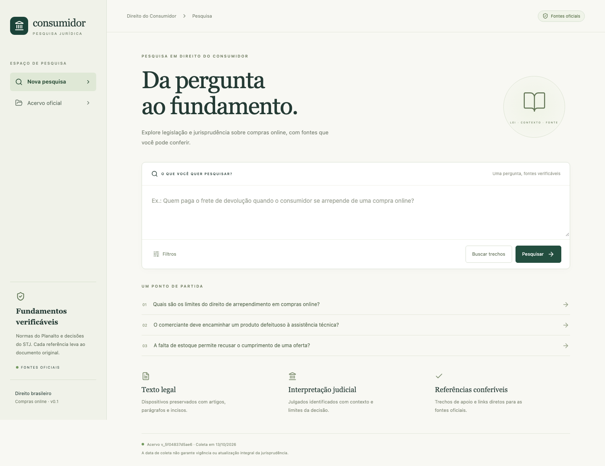

# consumidor-rag-mcp

Assistente de pesquisa em Direito do Consumidor brasileiro, voltado a advogados. Consulta um acervo de normas do Planalto e acórdãos selecionados do STJ, recupera trechos e produz respostas com referências verificáveis. Interface web, API REST e ferramentas MCP usam o mesmo serviço de pesquisa.

O acervo inicial cobre arrependimento, vícios e garantia, entrega, oferta e publicidade e cobrança indevida. Inclui CDC, Decreto nº 7.962/2013 e 15 acórdãos distintos: **17 documentos, 668 trechos**. O snapshot está incluído para instalação sem depender da disponibilidade dos portais oficiais.



## Execução com Docker

Requer Docker com Compose. Dentro da pasta do projeto:

```bash
cp .env.example .env
docker compose up --build -d
```

Abra **http://localhost:8080**. A API fica em http://localhost:3001 e o Qdrant em http://localhost:6333. Todas as portas publicadas ficam vinculadas a localhost. A primeira execução cria o índice textual automaticamente no volume persistente. Use **Buscar trechos** para consultar sem chave.

Para gerar respostas, configure `GEMINI_API_KEY` no `.env` e recrie a API:

```bash
docker compose up -d --force-recreate api
```

Para habilitar a busca híbrida, indexe os embeddings depois que Qdrant estiver disponível:

```bash
docker compose exec api pnpm corpus index
```

Essa operação chama a API Gemini para os embeddings e pode consumir quota. Falhas não substituem a versão ativa. Alterar modelo de embeddings ou dimensão exige nova indexação. A geração também funciona com índice textual; a interface identifica o modo usado.

Os defaults são `gemini-3.8-flash`, `gemini-embedding-2` e 768 dimensões. A chave é lida exclusivamente pelo backend e não é incluída no bundle web. Configure os modelos pelas variáveis do `.env.example`. O Embedding 2 recebe prefixos de tarefa no texto e um objeto Content por entrada; não recebe `taskType`. [Modelos Gemini](https://ai.google.dev/gemini-api/docs/models), [embeddings](https://ai.google.dev/gemini-api/docs/embeddings).

## Desenvolvimento local

Requer Node.js 24 e pnpm 12.11.2:

```bash
corepack enable pnpm
pnpm install --frozen-lockfile
pnpm corpus validate
pnpm corpus index --text-only
pnpm dev
```

Abra http://localhost:5173. Vite encaminha `/api` para http://127.0.0.1:3001. Para indexação vetorial local, configure a chave, inicie `docker compose up -d qdrant` e execute `pnpm corpus index`. `DATA_DIR` relativo é resolvido a partir da raiz do projeto.

## Ingestão, atualização e proveniência

```bash
pnpm corpus validate
pnpm corpus collect
pnpm corpus index --snapshot /caminho/da/coleta --text-only
pnpm corpus update --text-only
```

`collect` lê `data/manifest.json`, baixa somente URLs cadastradas e cria uma pasta única em `data/runtime/snapshots`. `update` coleta e indexa a nova versão; omita `--text-only` para indexar embeddings. `validate` verifica manifesto e snapshot incluído; `--manifest` e `--snapshot` permitem verificar uma coleta específica. O relatório registra falhas sem ativar dados incompletos.

Cada documento preserva URL oficial, URL final, órgão, data de coleta e SHA-256 dos bytes originais. Acórdãos incluem processo, órgão julgador, relatoria e datas. Normas são divididas por artigo, preservando seus parágrafos e incisos. PDFs digitais são divididos por página e trecho; documentos sem texto extraível são rejeitados. Texto riscado em normas é removido do índice.

A coleta usa HTTPS com validação de certificado, valida todos os redirecionamentos, restringe hosts, limita tamanho e possui timeout. O Planalto recebe TLS 1.2 por compatibilidade; o certificado continua sendo validado. Mudanças nos portais podem exigir ajustes de parsing. O arquivo original é preservado no snapshot, e alterações no texto normalizado são detectadas na validação.

Versões do acervo são identificadas pelo conteúdo, metadados e configuração do índice. As coleções vetoriais são isoladas por versão. O índice vetorial é concluído e contado antes da transação SQLite que ativa a versão; reindexação idêntica não duplica documentos. Versões antigas e coleções incompletas não são apagadas automaticamente.

Veja [proveniência e condições dos dados](data/PROVENIENCIA.md). A licença MIT aplica-se ao código; o acervo tem sua origem documentada separadamente.

## Pesquisa e API

A busca usa SQLite FTS5 com normalização de acentos e expansões de termos. Com embeddings configurados, combina até 20 resultados textuais e 20 vetoriais por Reciprocal Rank Fusion. Os mesmos filtros são aplicados nas duas modalidades e conferidos novamente no banco. Retorna até dez trechos, com limite total de contexto e limite de concentração por documento. Se a busca vetorial falhar, a textual continua disponível.

Gemini recebe apenas a pergunta e os trechos recuperados. Não usa pesquisa externa, grounding na web ou execução de instruções dos documentos. O backend valida schema, IDs recuperados, tipo de fonte por seção e correspondência de citações literais. Títulos e links vêm do banco, sem aceitar metadados inventados pelo modelo. Isso verifica integridade de referências; suporte semântico exige avaliação própria.

O schema enviado ao Gemini restringe os IDs por seção: legislação aceita somente normas, jurisprudência somente julgados e síntese pode combinar ambos. Se a recuperação não incluir fontes de um tipo, a seção correspondente deve ficar vazia. A validação no backend continua verificando essas regras após a geração.

| Endpoint | Função |
|---|---|
| `POST /api/search` | Busca de trechos |
| `POST /api/research` | Resposta estruturada, referências, limitações, versão e uso de tokens |
| `GET /api/documents` | Lista paginada e filtrada |
| `GET /api/documents/:id?version=...` | Documento completo na versão solicitada |
| `GET /api/corpus` | Versão ativa, cobertura, modelos e datas |
| `GET /api/health` | Disponibilidade da API e estado do índice textual |

Exemplo:

```bash
curl http://localhost:3001/api/search \
  -H 'Content-Type: application/json' \
  -d '{"question":"Quem paga o frete de devolução por arrependimento?","filters":{"topic":"arrependimento"},"limit":10}'
```

Filtros: `topic` (`arrependimento`, `garantia`, `entrega`, `oferta`, `cobranca`), `type` (`legislacao`, `jurisprudencia`), `publishedFrom` e `publishedTo` no formato `AAAA-MM-DD`. Datas afetam somente jurisprudência. A lista aceita `page` e `pageSize` (máximo 100).

Ausência de evidências usa `insufficient_evidence`. Falhas Gemini têm códigos distintos: `PROVIDER_NOT_CONFIGURED`, `PROVIDER_AUTH`, `PROVIDER_QUOTA`, `PROVIDER_TIMEOUT` e `PROVIDER_UNAVAILABLE`. Referência inválida usa `INVALID_CITATION`. Logs de pesquisa incluem IDs, versão, modelo, tempo e tokens; não incluem a pergunta por padrão.

A geração repete falhas transitórias HTTP 500, 502 e 503 até duas vezes, com pausas de 500 ms e 1 s, dentro do limite total de 45 s. Se o Gemini continuar com alta demanda (503), a pesquisa retorna `PROVIDER_UNAVAILABLE` e orienta tentar novamente em instantes. Erros de chave, quota e respostas inválidas não são repetidos.

## MCP

O servidor usa o SDK oficial, transporte stdio, e chama a mesma API. Ferramentas: `buscar_legislacao`, `buscar_jurisprudencia`, `obter_documento`, `pesquisar_consumidor`. Retorna conteúdo textual JSON e `structuredContent`, com erros identificados pelo protocolo. As duas ferramentas de busca fixam o tipo de fonte correspondente.

```bash
docker compose --profile mcp build mcp
docker compose run --rm --no-deps -T mcp
```

Use [examples/mcp-client.json](examples/mcp-client.json) no cliente MCP, ajustando o caminho se mover a pasta. O serviço API precisa estar em execução. Para iniciar fora do Docker:

```bash
API_URL=http://127.0.0.1:3001 pnpm --filter @consumidor/mcp start
```

## Verificação e avaliação

```bash
pnpm check
pnpm exec playwright install chromium
pnpm test:e2e
pnpm evaluate --text-only
pnpm evaluate --live
```

`check` executa typecheck, lint, testes e build. Os testes cobrem parsing, redirecionamentos, filtros, fusão, referências, transcrições, rollback, indexação incompleta, idempotência, erros do provedor e equivalência API/MCP. Playwright inicia serviços isolados com acervo real e provedor determinístico exclusivo de teste; cobre pesquisa, painel de fontes, exportação, filtros, falha de geração e viewport móvel. Não confunde esse provedor com integração Gemini real.

A avaliação tem **60 perguntas**: 40 respondíveis, oito ambíguas, oito sem suporte e quatro adversariais. A execução textual inicial teve **Hit@10 de 97,5% (39/40)**. Consulte o [relatório](data/evaluation/results-textual/REPORT.md) e os resultados individuais. As referências esperadas são dispositivos ou documentos; um hit não significa que todos os fundamentos necessários foram recuperados.

`--live` usa Gemini, registra tokens, latência, respostas e falhas e requer uma chave configurada. A [rubrica](data/evaluation/RUBRICA.md) descreve revisão humana e metas de suporte, abstenção e integridade. **A geração real e a avaliação semântica não foram executadas nesta entrega, por ausência de chave Gemini.** Seus resultados permanecem `null`/pendentes; nenhum percentual foi inventado. Custo monetário não é estimado automaticamente.

A CI executa checks, validação do snapshot, indexação textual, avaliação e Playwright sem chave. Integração real é um comando separado.

## Estrutura e limites

```text
apps/api/         Fastify, SQLite, Qdrant, Gemini, ingestão e avaliação
apps/web/         React, Vite e Tailwind
apps/mcp/         Ferramentas MCP via stdio
packages/shared/  Schemas Zod, contratos e exportação Markdown
data/             Manifesto, snapshot e avaliação
tests/            Testes de núcleo e interface
```

Pesquisas são independentes, sem contas, histórico persistente, uploads privados ou elaboração de peças. A versão de coleta não garante vigência nem atualização jurisprudencial integral. Algumas decisões tratam de fundamentos gerais em outros contextos de consumo; as justificativas do manifesto explicitam os limites. Um voto vencido ou argumento relatado não pode ser tratado como decisão final. Acórdãos isolados não são classificados como entendimento vinculante ou uniforme.

Publicação no GitHub e hospedagem pública ficam para uma etapa posterior. `HISTORICO.md` fica fora do Git e do Docker por conter a conversa de trabalho. O [plano original](PLAN.md) foi preservado.
